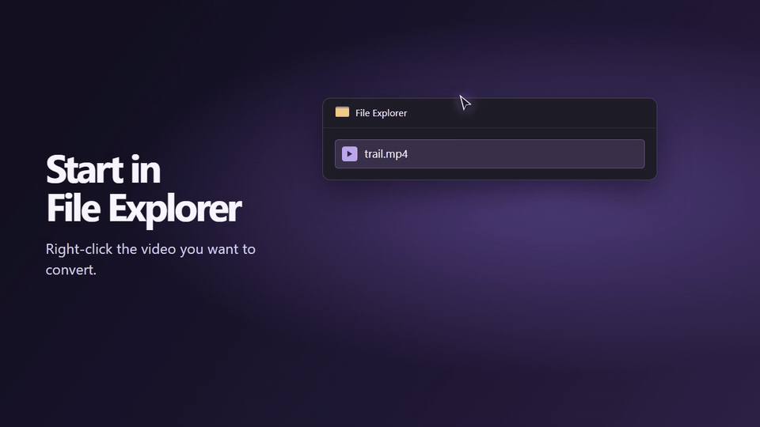

# Context Actions 0.1

Compress videos, resize images, combine scans into a PDF, and rename files in batches. A shared C++ core runs the same batch actions in WinUI 3 on Windows, AppKit on macOS, and GTK 4 on Linux.

The walkthrough recreates the File Explorer and WinUI 3 preview screens with a sample file.

## What you can do

- **Video.** Compress or convert to H.264 or H.265 MP4. Set quality, maximum width, frame rate, audio, and a file size limit, or use the silent Telegram preset.
- **Images.** Convert among JPEG, PNG, WebP, BMP, TIFF, and GIF, and resize without changing proportions.
- **PDF.** Create a PDF from images or merge images and existing PDFs in the order you choose.
- **Archives.** Repack ZIP, TAR, TAR.GZ, 7Z, and RAR archives to a different format. Choose ZIP, TAR.GZ, or 7Z and keep the source archive.
- **Batch rename.** Apply patterns, numbering, prefixes, suffixes, or text replacement. Preview the new names and undo the last rename when the files are unchanged and their original names are available.
- **Office to PDF.** Export supported documents and spreadsheets with Microsoft Word and Excel on Windows or LibreOffice Writer and Calc on macOS and Linux.

See the [format-to-format conversion table](docs/support.md#format-conversions) and the [file operations and limits](docs/support.md#file-operations).

Right-click selected files in Windows File Explorer, GNOME Files, or KDE Dolphin to open Context Actions. Use **Open With** in Finder or other Linux file managers, or add files in the app with the picker, drag and drop, or command-line arguments. Batches show per-file results and can be canceled. Conversions keep the originals and use unique output names. Scripts can run actions with `--headless` and `--report`.

The app uses shared English, Russian, German, French, and Simplified Chinese translations. The Windows app also offers theme controls and a way to check Microsoft Office availability again.

## App and installer builds

| Platform | Native app | GitHub Actions artifacts |
| --- | --- | --- |
| Windows 11 x64 | WinUI 3 and File Explorer integration | Portable ZIP and Inno Setup EXE |
| macOS 11+, Intel and Apple Silicon | AppKit with Finder file opening | Universal app ZIP and PKG |
| Linux x86-64 and ARM64 | GTK 4.6+ with GNOME Files and KDE Dolphin context menus | DEB, RPM, Arch x86-64 package, and portable tar archive |

Get app archives and installers from [GitHub Releases](https://github.com/ShortKedr/context-actions/releases). Windows Setup downloads and verifies the media tools and offers File Explorer integration as an opt-in option. The Windows portable app can use media tools on `PATH`. On macOS, install them with `brew install ffmpeg-full qpdf`. Linux packages declare their media dependencies. The portable Linux build uses the distribution's GTK 4, FFmpeg, and qpdf packages. [Local build and installation instructions](docs/build.md)

## Preview status

The installers are preview builds. The macOS package is unsigned and the app uses ad-hoc signing. The modern File Explorer menu has been exercised on a development machine. Classic **Show more options** integration, full UI coverage, clean-machine installation, and Office layout fidelity still need validation.

Standalone Office document and spreadsheet format conversion is planned for a later stage. PDF export is available with the platform's Office backend.

The original CMD and PowerShell prototypes are archived in [`legacy/`](legacy/) for reference. The distribution includes the native app and its bundled components. [Bundled components](docs/third-party.md)

[Original project plan](CONTEXT_ACTIONS_PLAN.md)
