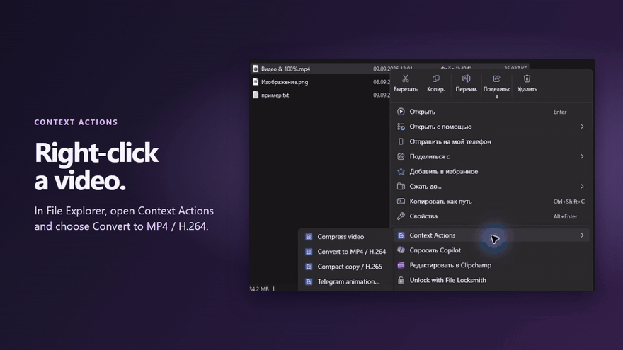
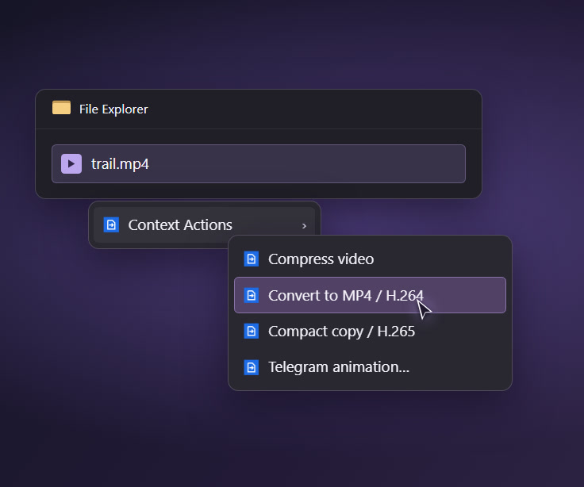
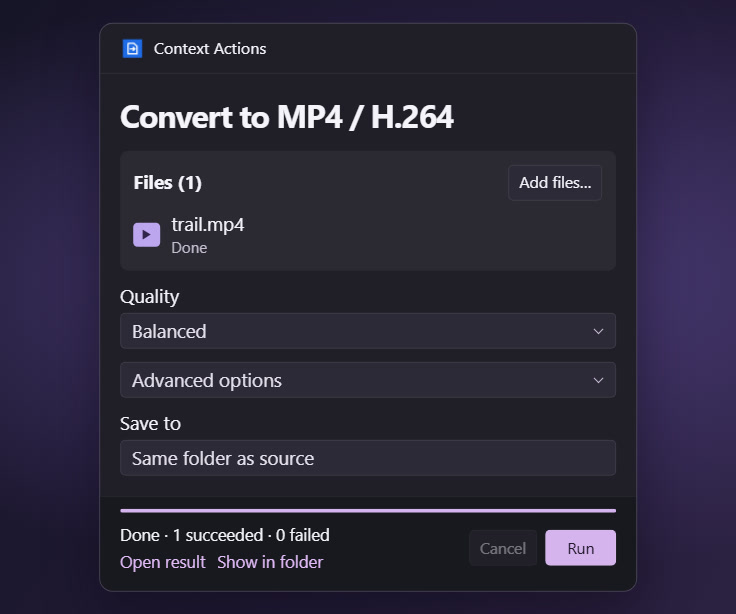

# Context Actions 0.1

Compress videos, resize images, combine scans into a PDF, and rename files in batches with a native Windows 11 x64 app. Start with a right-click in File Explorer or open the full workspace to build a file list.



[Watch the 10-second MP4](docs/showcase/demo.mp4) · [Open the interactive HTML tour](docs/showcase/index.html) in a browser from your local checkout.

## What you can do

- **Video.** Compress or convert to H.264 or H.265 MP4. Set quality, maximum width, frame rate, audio, and a file size limit, or use the silent Telegram preset.
- **Images.** Convert among JPEG, PNG, WebP, BMP, TIFF, and GIF, and resize without changing proportions.
- **PDF.** Create a PDF from images or merge images and existing PDFs in the order you choose.
- **Batch rename.** Apply patterns, numbering, prefixes, suffixes, or text replacement. Preview the new names and undo the last rename when the files are unchanged and their original names are available.
- **Office to PDF.** Export supported documents and spreadsheets through an installed copy of Word or Excel.

See the [format-to-format conversion table](docs/support.md#format-conversions) and the [file operations and limits](docs/support.md#file-operations).

Choose an action in File Explorer to open its compact window, or choose **More Actions…** for the full workspace. Add files through the picker, drag-and-drop, or command-line arguments. Batches show per-file results and can be canceled. Conversions keep the originals and use unique output names. Scripts can run actions with `--headless` and `--report`.

## Screens

| File Explorer right-click menu | Processing window |
| --- | --- |
|  |  |

The tour and stills recreate the File Explorer and WinUI 3 preview screens with sample files. The app and its Explorer menu support English, Russian, German, French, and Simplified Chinese. The interface offers theme controls and a way to check Office availability again.

## Build the preview

```powershell
.\scripts\build-and-package.ps1
```

- Portable app at `dist\ContextActions\ContextActions.exe`
- Preview installer at `dist\ContextActions-0.1.0-win-x64-setup.exe`

The build runs core and headless application checks. Packaging runs independently of app installation, registry changes, MSIX/COM registration, Office, and Explorer restarts. Explorer integration is an opt-in installer option and is off by default. [Build requirements and manual Explorer registration](docs/build.md)

## Preview status

Core and packaged media checks have passed. Selected flows in the WinUI development preview, including activation from modern File Explorer, have been exercised on a development machine. Classic **Show more options** integration remains unresolved in that preview. Full UI, clean-machine, and Office validation are pending.

Standalone Office document and spreadsheet conversion is planned for a later stage. The action catalog shows those entries and explains their availability. PDF export through Word or Excel is a separate preview feature.

The original CMD and PowerShell prototypes are archived in [`legacy/`](legacy/) for reference. The distribution includes the native app and its bundled components. [Bundled components](docs/third-party.md)

[Original project plan](CONTEXT_ACTIONS_PLAN.md)
